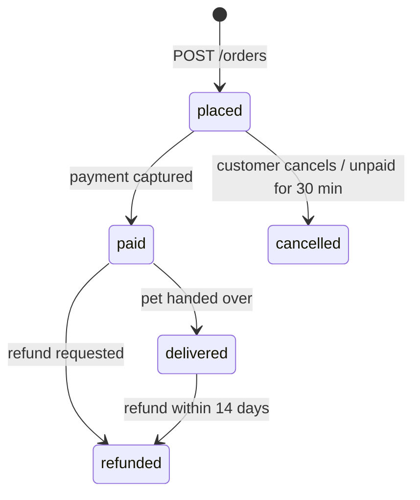

# Petstore API

The Petstore API is the backend of a fictional pet adoption shop. Customers browse the pet catalogue, place adoption orders, pay for them and can cancel or get a refund.

## Domains

| Domain | What it owns |
|--------|--------------|
| `pets` | Pet catalogue, availability, photos |
| `orders` | Adoption orders, reservations, cancellations, refunds |

## Order lifecycle

## Key business rules

- A pet can be in at most one open order. Placing an order **reserves** the pet (`status = reserved`).
- An order may contain at most **3 pets**.
- Unpaid orders expire after **30 minutes**; the reservation is released (see `jobs/expire-unpaid-orders`).
- Refunds are possible up to **14 days** after delivery; the adoption fee is refunded in full, the delivery fee is not.

## External Dependencies

- service: payments-gateway — card authorisation and capture
- service: notifications-service — customer e-mails and push notifications
- topic: `petstore.order-events` — order lifecycle events
- table: pets
- table: orders
