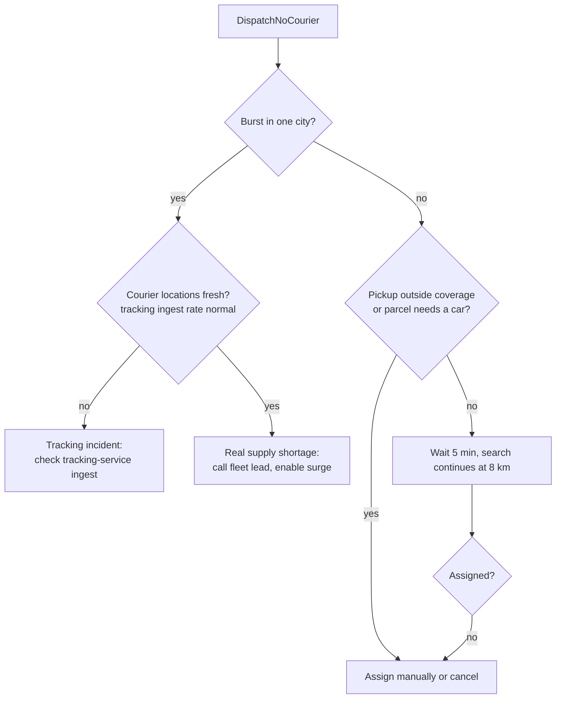

# Runbook: no couriers available

## Alert

| Alert | Fires when | Severity |
|-------|------------|----------|
| `DispatchNoCourier` | An assignment reached 3 offers without acceptance | warning, per order |
| `DispatchNoCourierBurst` | More than 10 `DispatchNoCourier` in one city within 15 min | page dispatch on-call |
| `DispatchStaleRepeated` | An order went stale a third time (`jobs/reassign-stale-assignments`) | warning |

The customer has paid; the 2-hour delivery promise is at risk. Target: courier assigned or order cancelled within 20 minutes of the alert.

## Triage



## Steps

1. Open the order in the ops console; check `assignments` and `courier_offers` for the order:
   ```sql
   SELECT a.status, a.radius_m, a.offer_count, o.courier_id, o.result, o.distance_m
   FROM assignments a JOIN courier_offers o ON o.assignment_id = a.id
   WHERE a.order_id = :order_id ORDER BY o.sent_at;
   ```
2. If all offers `timeout` with tiny `distance_m`, suspect the courier app push (service: courier-app-push) — check its error rate first.
3. If no courier sent a location in the last 60 s in the city, it is a tracking problem: check the ingest rate of `tracking/ingest-courier-location` (normally ~1 request per courier every 5 s).
4. For a single order: phone the nearest couriers from the console map and use `dispatch/reassign-courier` with `preferred_courier_id` (must be free and within 8 km).
5. If nobody can take it within 20 minutes of the alert, cancel the order as ops via orders-service `orders/cancel-order` as an ops cancellation (`reason = ops`, `fee_waived = true`, comment `no courier`). Ops cancellations are always free: billing refunds the full amount (`refunds/issue-refund`), even if a courier had been assigned earlier.
6. For a burst: ask the fleet lead to call in standby couriers; the surge price (x1.5 when fewer than 3 free couriers within 3 km) applies automatically to new quotes.

## After the incident

- Note the order ids in the incident channel; support sends a 5.00 EUR voucher for cancelled orders.
- If stale reassignments caused it, check `ops/stuck-orders` in orders-service for orders stuck in `courier_assigned`.
