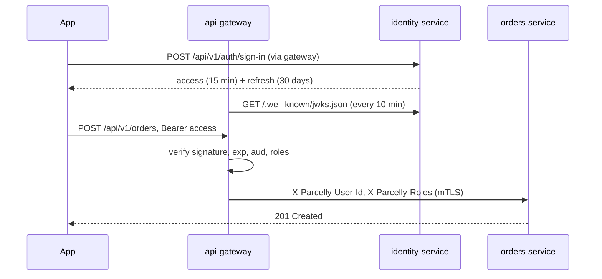

# ADR: Authenticate at the edge

- **Status:** accepted (2025-03-12)
- **Deciders:** platform team, identity team, security
- **Supersedes:** per-service session lookup against identity-service

## Context

Before this decision every backend service called identity-service (`GET /internal/sessions/{token}`) to validate the
opaque session token on each request. At peak (Friday 17:00–19:00) this produced ~4,000 req/s on identity-service,
added 20–40 ms per request and made identity-service a single point of failure: a 7-minute identity outage on
2025-02-07 took down order creation, tracking and the courier app at the same time.

## Decision

1. identity-service issues short-lived **JWT access tokens** (ES256, 15 minutes) and opaque **refresh tokens** (30 days,
   rotated on every refresh).
2. The gateway verifies the JWT signature, `exp`, `nbf`, `iss = https://id.parcelly.eu` and `aud = parcelly-api` using the
   JWKS published by identity-service, cached for 10 minutes.
3. After verification the gateway strips client-supplied `X-Parcelly-*` headers and injects `X-Parcelly-User-Id`
   (the `sub`), `X-Parcelly-Roles` and `X-Parcelly-Token-Id` (the `jti`).
4. Backend services trust these headers **only** on the internal mesh port (mTLS between gateway and services);
   the public port of each service is not exposed.
5. Revocation: tokens are not revoked individually. Signing out revokes the refresh token family; an access token stays
   valid until `exp` (max 15 minutes). Account suspension publishes `user.suspended` and the gateway keeps a deny-list of
   suspended `sub`s for 15 minutes.

## Consequences

| | |
|---|---|
| + | No per-request call to identity-service; p99 latency of order creation fell from 180 ms to 120 ms |
| + | Identity outage only affects sign-in and refresh; already signed-in users keep working for up to 15 minutes |
| − | Access tokens cannot be revoked instantly; mitigated by the 15-minute TTL and the suspension deny-list |
| − | Services must never be reachable bypassing the gateway (enforced by network policy `deny-public-ingress`) |
| − | Key rotation must publish the new key in JWKS at least 10 minutes before it signs tokens |

## Rejected alternatives

- **Each service verifies the JWT itself** — duplicated library code in 5 languages; drift in claim checks.
- **Opaque tokens with gateway-side cache** — still needs identity-service on cache misses and complicates revocation.
- **mTLS client certificates for apps** — impractical for consumer mobile apps.
