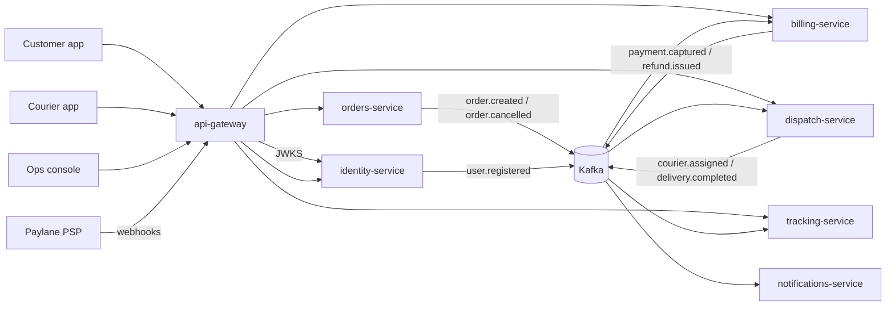

# API Gateway

The API gateway is the single public entry point of Parcelly. Every request from the customer app, the courier app,
the ops console and the Paylane webhooks enters through `api.parcelly.eu` and is handled here before it reaches a
backend service. The gateway is stateless (Envoy + a small Go control plane, `gatewayd`) and runs as 6 replicas
behind the cloud load balancer, 2 per availability zone.

## Responsibilities

| Concern | What the gateway does |
|---------|-----------------------|
| TLS | Terminates TLS 1.3 (TLS 1.2 only for the Paylane webhook range) |
| Authentication | Verifies the JWT access token at the edge (see `decisions/gateway-auth-at-edge`) |
| Routing | Maps path prefixes to backend services (see `gateway/routing`) |
| Rate limiting | Per user, per IP and per courier limits (see `gateway/rate-limits`) |
| Request ids | Generates `X-Request-Id` (UUID v7) if absent and propagates W3C `traceparent` |
| Header hygiene | Strips client-supplied `X-Parcelly-*` headers, injects trusted `X-Parcelly-User-Id`, `X-Parcelly-Roles` |
| WebSockets | Upgrades `/api/v1/orders/{order_id}/stream` and pins it to one tracking-service pod |

## Topology

## Request path

1. Load balancer forwards to a gateway replica; Envoy terminates TLS.
2. The route is resolved from the route table (`gateway/routing`). Unknown prefixes return `404` without touching a backend.
3. For authenticated routes the `Authorization: Bearer` JWT is verified against the identity-service JWKS
   (cached 10 minutes, refreshed on unknown `kid`). Expired or invalid tokens get `401` with `WWW-Authenticate: Bearer error="invalid_token"`.
4. Rate limits are evaluated in the local token bucket and synchronised every 1 s through Redis (`gateway/rate-limits`).
5. Trusted identity headers are injected and the request is proxied with a 10 s upstream timeout (30 s for `POST /api/v1/orders`
   because it waits on the quote lookup and the outbox insert).
6. Upstream `5xx` responses are passed through with a generic body; the original body is logged with the request id.

## External Dependencies

- service: identity-service — JWKS at `/.well-known/jwks.json`
- service: orders-service
- service: billing-service
- service: dispatch-service
- service: tracking-service
- Redis cluster `gateway-ratelimit` — shared rate-limit counters

## SLOs

| SLO | Target |
|-----|--------|
| Availability (non-5xx from the gateway itself) | 99.95% / 30 days |
| Added latency p99 | < 15 ms |
| JWKS refresh failures tolerated | 24 h with cached keys |
