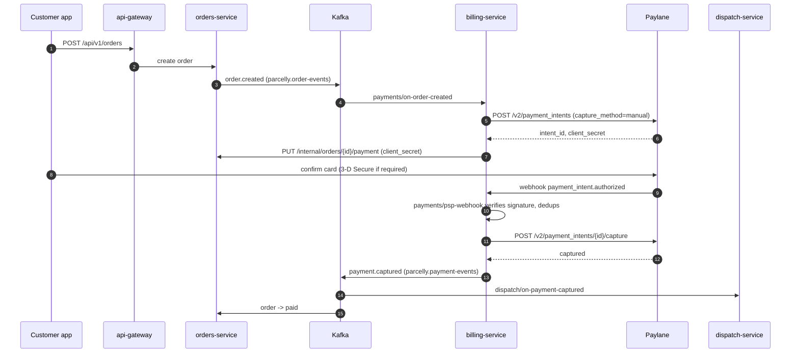

# Billing service

The billing service owns every movement of money at Parcelly: it creates a payment intent at the PSP (Paylane) for each
new order, captures the payment once the customer has authorised it, and issues refunds when an order is cancelled.
It never computes delivery prices — the price comes from orders-service in `order.created` — and it never stores card data.

## Responsibilities

| Area | What billing does | Document |
|------|-------------------|----------|
| Payment intents | Creates a Paylane intent per order, manual capture, expires with the order after 15 minutes | `payments/on-order-created` |
| PSP callbacks | Verifies and de-duplicates Paylane webhooks | `payments/psp-webhook` |
| Capture | Captures authorised intents, publishes `payment.captured` | `payments/capture-payment` |
| Cancellations | Voids or refunds on `order.cancelled`, applying the 3.00 EUR fee after courier assignment | `payments/on-order-cancelled` |
| Refunds | Full refund minus the cancellation fee, via Paylane | `refunds/issue-refund` |

## Payment flow

## Key business rules

- Currency is always **EUR**; amounts are stored as integer cents (`amount_cents`).
- Valid order totals are between **4.90 EUR** (base price, 0 km) and **37.35 EUR** (25 km with x1.5 surge: (4.90 + 25 x 0.80) x 1.5). Anything outside is rejected as a pricing bug.
- A payment intent expires **15 minutes** after the order was created, in sync with `jobs/expire-unpaid-orders` in orders-service.
- Cancellation before a courier is assigned is **free**: an uncaptured intent is voided, a captured one is fully refunded.
- Cancellation after courier assignment costs **3.00 EUR**: the refund is the captured amount minus 300 cents.
- Refunds go back to the original payment method and arrive within **5–10 business days**.
- v1 supports **full refunds only** (minus the cancellation fee where it applies).

## Data

- table: payments — one row per order and payment intent (see `schemas/payments`)
- table: refunds — one row per refund attempt
- table: psp_events — processed Paylane webhook ids, kept 30 days

## External Dependencies

- service: paylane — PSP (see `decisions/psp-choice`)
- service: orders-service — receives the `client_secret` for the checkout screen; reads payment state through billing's `GET /internal/payments/by-order/{order_id}` (status, captured and refunded amounts) for `orders/get-order`
- topic: `parcelly.order-events` — consumed (`order.created`, `order.cancelled`)
- topic: `parcelly.payment-events` — produced (`payment.captured`, `payment.failed`, `refund.issued`)
- queue: `billing.dead-letter`

## SLOs

| Indicator | Target |
|-----------|--------|
| `order.created` -> intent created (p99) | < 2 s |
| Webhook -> `payment.captured` published (p99) | < 3 s |
| Webhook endpoint availability | 99.95% |
