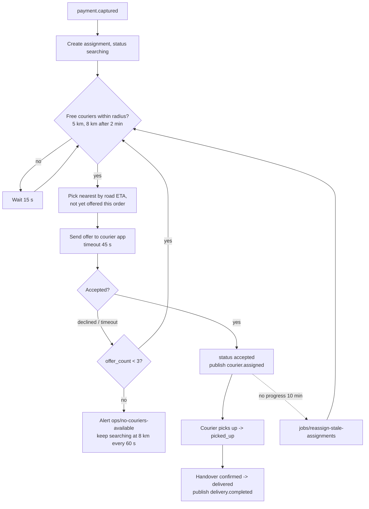

# Dispatch service

Dispatch decides which courier delivers which order. It starts when billing has captured the payment, offers the order
to the nearest free courier, watches the assignment until delivery and publishes the dispatch events the rest of
Parcelly reacts to.

## Responsibilities

| Area | Document |
|------|----------|
| Start dispatch for paid orders | `dispatch/on-payment-captured` |
| Courier matching and offers | `dispatch/assign-courier` |
| Manual reassignment by ops | `dispatch/reassign-courier` |
| Release the courier when an order is cancelled | `dispatch/on-order-cancelled` |
| Detect couriers that don't move toward the pickup | `jobs/reassign-stale-assignments` |
| Events | `events/courier-assigned`, `events/delivery-completed` |

## Assignment algorithm

## Key business rules

- Dispatch starts only after `payment.captured`; unpaid orders never reach dispatch.
- Search radius **5 km** around the pickup, widened to **8 km** two minutes after the search started.
- An offer is valid for **45 s**. At most **3 offers** per search; after the third rejection or timeout ops is alerted (`ops/no-couriers-available`).
- A courier holds at most one active assignment.
- A courier that has not moved toward the pickup for **10 minutes** is replaced automatically.
- After pickup, the order can no longer be cancelled (orders-service answers `409`) or reassigned.
- Couriers count as free when they are online, have no active assignment and sent a location in the last 60 s.
- Fewer than 3 free couriers within 3 km of a pickup triggers the x1.5 surge in orders-service pricing; dispatch exposes that count as `GET /internal/couriers/free-count?lat=&lng=&radius_m=3000`, called by orders-service `orders/quote-delivery`.

## External Dependencies

- topic: `parcelly.payment-events` — consumed (`payment.captured`)
- topic: `parcelly.order-events` — consumed (`order.cancelled`)
- topic: `parcelly.dispatch-events` — produced (`courier.assigned`, `courier.picked_up`, `delivery.completed`)
- service: tracking-service — courier positions and ETAs (`GET /internal/couriers/nearby`)
- service: courier-app-push — offers to courier phones
- table: assignments
- table: courier_offers
- queue: `dispatch.dead-letter`
