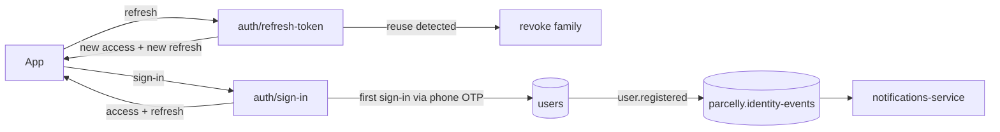

# Identity service

identity-service owns every Parcelly account (customers, couriers and ops staff), signs users in and issues the tokens
the gateway verifies at the edge (see the api-gateway ADR `decisions/gateway-auth-at-edge`). It is a Kotlin/Spring
service with its own Postgres database `identity` and 3 replicas.

## Domains

| Domain | What it owns |
|--------|--------------|
| `auth` | Sign-in, refresh token rotation, sign-out, JWKS and signing keys |
| `users` | Profiles, roles, phone/e-mail verification, suspension |

## Token model

| Token | Format | TTL | Stored | Notes |
|-------|--------|-----|--------|-------|
| Access token | JWT, ES256 | 15 minutes | not stored | Claims: `sub`, `roles`, `jti`, `iss`, `aud`, `exp` |
| Refresh token | opaque, 256 bit | 30 days | SHA-256 only, table: refresh_tokens | Rotated on every refresh; reuse revokes the family |
| Signing key | P-256 key pair | rotated every 90 days | KMS | Published in JWKS 24 h before first use |

## Roles

| Role | Who | Notes |
|------|-----|-------|
| `customer` | Anyone who signs up in the customer app | Default role |
| `courier` | Onboarded couriers | Granted by ops after document check; a courier account cannot hold `customer` |
| `ops` | Parcelly staff | Only via SSO (Google Workspace); password sign-in disabled |

## Key business rules

- Access tokens live **15 minutes**, refresh tokens **30 days**, rotated on every refresh.
- 5 sign-in attempts per e-mail per 15 minutes (enforced at the gateway, `gateway/rate-limits`) and 10 consecutive
  failures lock the account for 30 minutes here.
- Suspending a user revokes all refresh token families and publishes `user.suspended` to topic: `parcelly.identity-events`.
- New accounts publish `user.registered` (see `events/user-registered`).

## External Dependencies

- table: users
- table: refresh_tokens
- topic: `parcelly.identity-events`
- service: notifications-service — OTP SMS and welcome e-mail (via the `user.registered` event)
- AWS KMS — signing keys
