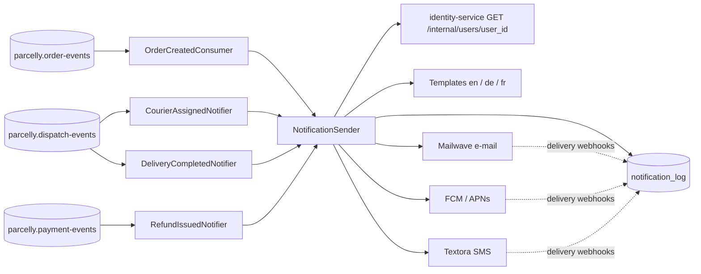

# Notifications service

The notifications service turns domain events into messages to customers: e-mail, mobile push and SMS. Every message
goes through one internal entry point, `notifications/send-notification`, which applies preferences, quiet hours,
deduplication, locale templates and channel fallbacks, and records each attempt in table: notification_log. The service
has no public HTTP API; it only consumes events.

## Event → notification matrix

| Event | Topic | Consumer | Template | Channels (in order) | Urgency |
|-------|-------|----------|----------|---------------------|---------|
| `order.created` | `parcelly.order-events` | `notifications/on-order-created` | `order_created` | e-mail | normal |
| `courier.assigned` | `parcelly.dispatch-events` | `notifications/on-courier-assigned` | `courier_assigned` | push → SMS | urgent |
| `delivery.completed` | `parcelly.dispatch-events` | `notifications/on-delivery-completed` | `delivery_completed` | push + e-mail | normal |
| `refund.issued` | `parcelly.payment-events` | `notifications/on-refund-issued` | `refund_issued` | e-mail | low |

## Architecture

## Policies

- **Locales**: templates exist in `en`, `de` and `fr`; the profile locale (`de-DE`) is reduced to its language, and
  any other language (e.g. `pl-PL`) falls back to `en`.
- **Quiet hours**: 22:00–08:00 in the recipient's time zone. Urgent messages ignore them; normal push is downgraded
  to e-mail only; low-urgency messages are deferred to 08:00.
- **Deduplication**: `dedup_key = <event_type>:<aggregate_id>[:<suffix>]`, unique for 7 days.
- **Fallback**: an urgent push not confirmed delivered within 60 s is resent as SMS.
- **Rate limits**: at most 1 SMS per order per 10 minutes and 5 SMS per user per day.
- **Contact data** is loaded from identity-service (see `users/get-profile`) and cached for 10 minutes; it is never
  copied into the log, which stores only a masked address.

## External Dependencies

- topic: `parcelly.order-events`
- topic: `parcelly.dispatch-events`
- topic: `parcelly.payment-events`
- topic: `parcelly.identity-events` — `user.registered` (welcome e-mail) and `user.updated` (cache eviction)
- service: identity-service
- service: mailwave — transactional e-mail
- service: fcm, service: apns — push
- service: textora — SMS
- table: notification_log
- queue: `notifications.dead-letter`

## Ownership

Team **Customer Comms** (#team-comms). Template copy is owned by the CX team and changed through pull requests to
`templates/`.
