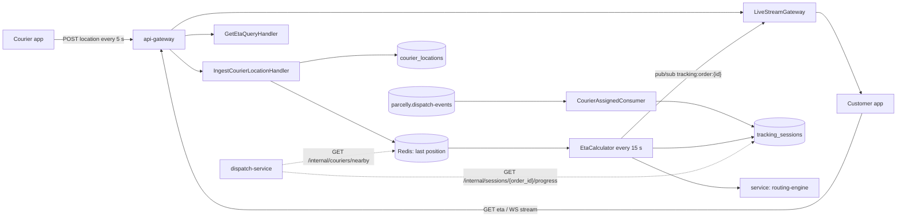
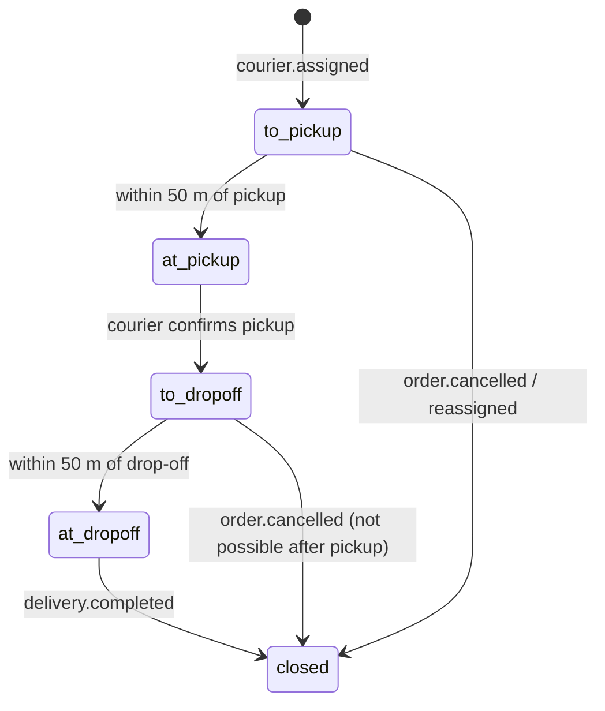

# Tracking service

The tracking service knows where every active courier is and when each parcel will arrive. It starts a
**tracking session** when dispatch assigns a courier, ingests the courier app's GPS pings, recalculates the ETA
and pushes live updates to the customer's app over a WebSocket. It owns no order state: the order lifecycle lives in
`orders-service`, the assignment in `dispatch-service`.

## Responsibilities

| Area | What it does | Document |
|------|--------------|----------|
| Session start | Consumes `courier.assigned`, opens a tracking session | `tracking/on-courier-assigned` |
| GPS ingestion | Accepts a ping every 5 s from the courier app, validates and stores it; serves nearby couriers to dispatch | `tracking/ingest-courier-location` |
| ETA | Recalculates pickup and drop-off ETA every 15 s per session | `tracking/get-eta` |
| Live view | Streams position and ETA to customers over WebSocket | `tracking/live-stream` |
| Session end | Consumes `delivery.completed` and `order.cancelled`, closes the session | `tracking/on-courier-assigned` |

## Architecture

## Tracking session lifecycle

## Key numbers

| Parameter | Value |
|-----------|-------|
| GPS ping interval (courier app, moving) | 5 s |
| GPS ping interval (courier app, stationary > 60 s) | 30 s |
| ETA recalculation | every 15 s per open session |
| Geofence radius for "arrived" | 50 m |
| Max accepted GPS accuracy | 75 m |
| Raw ping retention | 30 days, then aggregated |
| WebSocket heartbeat | ping every 20 s, closed after 2 missed pongs |
| Max concurrent stream connections per order | 5 |

## Stale assignments

The tracking service does not reassign couriers itself. It computes `progress_toward_pickup_m` for every session in
`to_pickup`, and `dispatch-service` reads it through the internal progress endpoint in its job
`jobs/reassign-stale-assignments` (no movement toward pickup for 10 minutes means reassign). When a courier is
reassigned, a new `courier.assigned` arrives and the old session is closed with reason `reassigned`.

## External Dependencies

- topic: `parcelly.dispatch-events` — `courier.assigned`, `delivery.completed`
- topic: `parcelly.order-events` — `order.cancelled`
- service: routing-engine — road-network travel times (self-hosted OSRM)
- service: dispatch-service — reads session progress
- table: tracking_sessions
- table: courier_locations
- queue: `tracking.dead-letter`

## Ownership

Team **Live Ops** (#team-live-ops). On-call rotation shared with dispatch-service.
