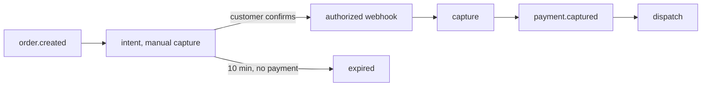

# ADR-007: Paylane as payment service provider

- **Status:** accepted
- **Date:** 2025-03-12
- **Deciders:** billing team, CTO, finance

## Context

Parcelly charges small amounts (4.90–37.35 EUR) many times a day, mostly by card and Apple Pay / Google Pay, in the
EU only. We need SCA / 3-D Secure, refunds back to the original method, payouts to couriers, and no card data in our
systems (stay at PCI DSS SAQ A). Courier dispatch must start only after the money is secured.

## Options

| Criterion | Paylane | Stripe-direct competitor "CardHub" | Bank acquirer + own gateway |
|-----------|---------|------------------------------------|-----------------------------|
| Fee per EU card transaction | 1.2% + 0.15 EUR | 1.5% + 0.25 EUR | ~0.9% + 0.10 EUR |
| Manual capture | yes, 7 days | yes, 7 days | yes |
| Hosted card fields (SAQ A) | yes | yes | no — SAQ D |
| Courier payouts (marketplace) | yes | add-on, +0.5% | no |
| Webhook signing | HMAC-SHA256 with timestamp | HMAC-SHA1 | n/a |
| Integration estimate | 3 weeks | 3 weeks | 4+ months |

On a 9.70 EUR average basket Paylane costs about 0.27 EUR per order versus 0.40 EUR at CardHub.

## Decision

Use **Paylane** with **manual capture**: authorise at checkout, capture as soon as the authorisation webhook arrives
(`payments/capture-payment`), and only then publish `payment.captured`, which starts courier dispatch.

## Consequences

- Webhooks are the source of truth; `payments/psp-webhook` must verify signatures and de-duplicate (`psp_events`).
- Voiding an uncaptured intent is free, which makes free cancellation before assignment cheap.
- Refunds cost nothing at Paylane, but the original transaction fee is not returned — one reason for the 3.50 EUR cancellation fee after assignment.
- Lock-in risk: the `PaymentProvider` port in billing hides Paylane; a second PSP could be added behind it.
- Like edge auth in api-gateway (`decisions/gateway-auth-at-edge`), the webhook route is public and authenticated by signature, not JWT.
