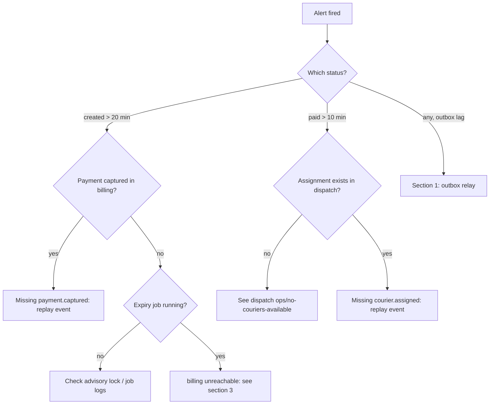

# Runbook: stuck orders

**Alerts:** `OrdersStuckCreated`, `OrdersStuckPaid`, `OrdersOutboxLag`, `OrdersExpiryBillingUnreachable`.
**Owner:** orders team (#team-orders), escalation to on-call via PagerDuty service `orders-service`.

## Symptoms and triage



| Alert | Threshold |
|-------|-----------|
| `OrdersStuckCreated` | > 20 orders in `created` with `expires_at < now() − 5 min` |
| `OrdersStuckPaid` | > 10 orders in `paid` for more than 10 minutes |
| `OrdersOutboxLag` | oldest unpublished outbox row older than 60 s |

## 1. Outbox relay lag

```sql
SELECT count(*), min(id), now() - min(o.payload->>'occurred_at')::timestamptz AS lag
FROM orders_outbox o WHERE published_at IS NULL;
```

1. Check the relay pods: `kubectl -n orders logs deploy/orders-outbox-relay --since=10m`.
2. Kafka unavailable → follow the platform Kafka runbook; the outbox holds events safely, no data loss.
3. A poison row (serialisation error) blocks the relay: move it with `orders-admin outbox park <id>`, then file a bug.

## 2. Orders stuck in `created` with a captured payment

The `payment.captured` event never arrived (billing outbox or our consumer failed).

1. Check the consumer's dead letter queue: queue: `orders.dead-letter`.
2. Confirm in billing: `GET /internal/payments/by-order/{order_id}` returns `captured`.
3. Replay: `orders-admin events replay --topic parcelly.payment-events --order <order_id>`.
4. Never set `status = paid` by hand: dispatch-service also needs the event.

## 3. Expiry job not expiring

`ExpireUnpaidOrdersJob` skips orders while billing-service is unreachable. Unpaid orders normally expire 10 minutes
after creation (plus 30 s grace). Once billing is back the job catches up in batches of 500.

## 4. Orders stuck in `paid`

Usually no courier is available: follow dispatch-service `ops/no-couriers-available`. If the customer has waited more
than 30 minutes, ops may cancel with `waive_fee = true` (`orders/cancel-order`) — the fee would be 0.00 anyway before
assignment and in the first 2 minutes after it, but if a courier was assigned and is not moving, a waived
cancellation avoids the 3.50 EUR fee.
Alternatively reassign via `POST /api/v1/dispatch/{order_id}/reassign`.

## Useful queries

```sql
SELECT status, count(*) FROM orders
WHERE updated_at < now() - interval '10 minutes'
  AND status IN ('created','paid','courier_assigned')
GROUP BY status;
```
