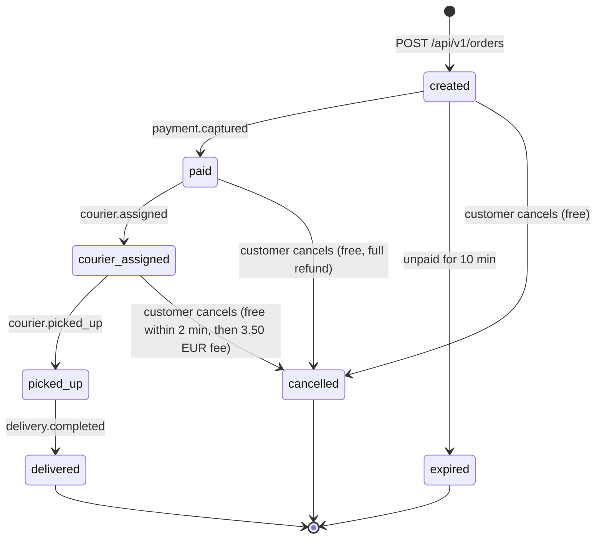
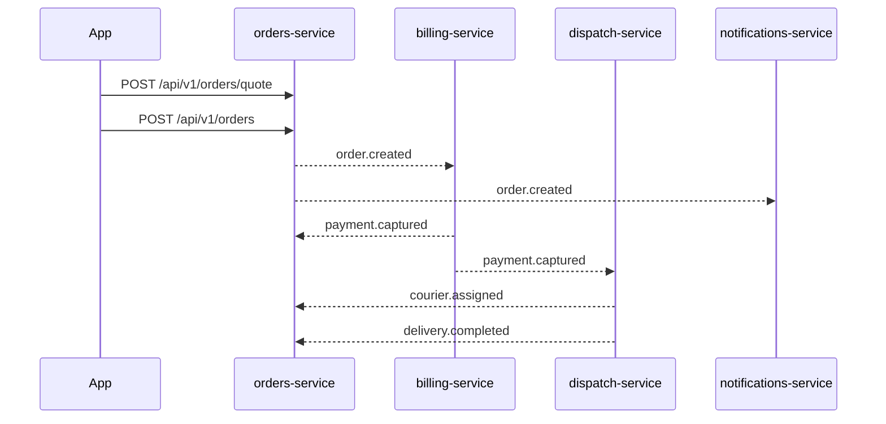

# Orders service

orders-service owns the customer's delivery order from the price quote to delivery or cancellation. It is the start of
the Parcelly flow: an order created here triggers payment (billing-service), courier assignment (dispatch-service),
live tracking (tracking-service) and customer messages (notifications-service). Node.js/TypeScript, Postgres database
`orders`, 4 replicas behind the api-gateway.

## Domains

| Domain | What it owns |
|--------|--------------|
| `orders` | Quotes, orders, status transitions, cancellation and cancellation fees |
| `events` | `order.created`, `order.cancelled` published to topic: `parcelly.order-events` |
| `jobs` | Expiry of unpaid orders |

## Order lifecycle

Status changes after `created` are driven by events the service consumes:

| Event | Topic | Producer | Transition |
|-------|-------|----------|------------|
| `payment.captured` | `parcelly.payment-events` | billing-service | `created → paid` |
| `courier.assigned` | `parcelly.dispatch-events` | dispatch-service | `paid → courier_assigned` (also on reassignment, keeps status) |
| `courier.picked_up` | `parcelly.dispatch-events` | dispatch-service | `courier_assigned → picked_up` |
| `delivery.completed` | `parcelly.dispatch-events` | dispatch-service | `picked_up → delivered` |

## Key business rules

- **Price**: base 4.90 EUR + 0.80 EUR/km of route distance; x1.5 surge when fewer than 3 couriers are free within 3 km
  of the pickup. Maximum distance 25 km, maximum parcel weight 20 kg (`orders/quote-delivery`).
- A quote is valid for **10 minutes**; an order must reference a valid quote.
- An optional **tip** of 0–20 EUR can be added at order creation; it is added to the total and passed through to
  billing-service, which pays it out to the courier in full.
- **Unpaid orders expire after 10 minutes** (`jobs/expire-unpaid-orders`).
- **Cancellation** is free until a courier is assigned and within **2 minutes** after assignment. After that a
  cancellation fee of **3.50 EUR** applies.
  After pickup cancellation is impossible (`409`). See `orders/cancel-order`.
- Refunds are issued by billing-service: full amount minus the cancellation fee, back to the original payment method
  within 5–10 business days.
- All amounts in EUR with 2 decimals, timestamps UTC ISO-8601, ids UUID v7.

## End-to-end flow

## External Dependencies

- table: orders
- table: quotes
- table: orders_outbox
- topic: `parcelly.order-events` (publishes)
- topic: `parcelly.payment-events`, topic: `parcelly.dispatch-events` (consumes)
- service: dispatch-service — free courier count for surge pricing
- service: billing-service — payment client secret for the app
- Google Routes API — route distance for quotes
- queue: `orders.dead-letter`
